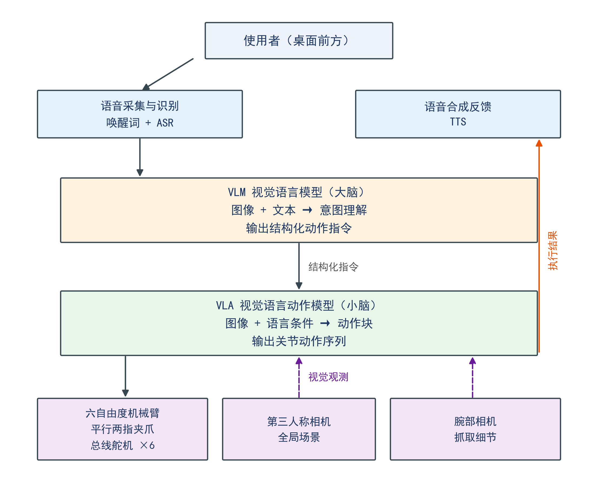

# vlm-vla-voice-arm

基于 **VLM 大脑 + VLA 小脑** 的中文语音控制机械臂系统。使用者用日常口语下达抓放指令，机械臂完成目标选择、抓取与放置，并以语音回复结果。

运行环境：**Ubuntu 22.04 + ROS 2 Humble**。



## 架构

| 层次 | 角色 | 输入 | 输出 |
|---|---|---|---|
| VLM | 大脑 | 指令文本 + 桌面图像 | 结构化动作指令 |
| VLA | 小脑 | 图像 + 语言条件 | 关节动作块（16 步 × 6 关节） |

两层之间以 `TaskCommand` 消息为唯一接口。VLM 不接触关节空间，VLA 不解析自然语言。

## ROS2 包结构

```
ros2_ws/src/
├── voice_arm_interfaces/   自定义消息：TaskCommand / ActionChunk / RobotStatus
├── voice_arm_core/         纯 Python 核心库，不依赖 ROS2，可单独 pytest
└── voice_arm_bringup/      ROS2 节点与 launch，只做消息转换
```

**设计原则：核心逻辑不进节点。** 节点只负责「收到消息 → 调核心库 → 发布结果」，这样单元测试不需要 ROS2 环境。

## 话题

| 话题 | 类型 | 方向 |
|---|---|---|
| `/voice/instruction` | `std_msgs/String` | audio → vlm |
| `/camera/front/image_raw` | `sensor_msgs/Image` | robot → vlm |
| `/task/command` | `voice_arm_interfaces/TaskCommand` | vlm → policy, orchestrator |
| `/robot/action_chunk` | `voice_arm_interfaces/ActionChunk` | policy → robot |
| `/robot/joint_states` | `sensor_msgs/JointState` | robot → 外部 |
| `/robot/status` | `voice_arm_interfaces/RobotStatus` | robot → orchestrator |
| `/voice/reply` | `std_msgs/String` | orchestrator → audio |

## 快速开始

```bash
# 依赖
sudo apt install ros-humble-desktop python3-colcon-common-extensions
pip install -e "ros2_ws/src/voice_arm_core"   # 可选，便于本地开发

# 构建
make build

# 单元测试（不需要 ROS2 环境）
make test

# 仿真启动
make sim

# 真机启动（硬件就绪后）
make real
```

## 当前状态

| 部分 | 状态 |
|---|---|
| ROS2 骨架与话题 | ✅ 已就位 |
| 核心库接口 | ✅ 已定义，12 个测试通过 |
| 仿真节点 | ✅ 可启动，产生占位动作 |
| VLM 接入 | ⏳ 调 `voice_arm_core.vlm.client` |
| 真机驱动 | ⏳ 队友实现 `robot_node` 回调 |
| 语音链路 | ⏳ 接入 openWakeWord / FunASR / edge-tts |

## 文档

- [架构说明](docs/architecture.md)
- [接口契约](docs/interface.md)
- [指令 Schema](docs/schema.md)
- [环境搭建](docs/setup.md)

## 许可

MIT
