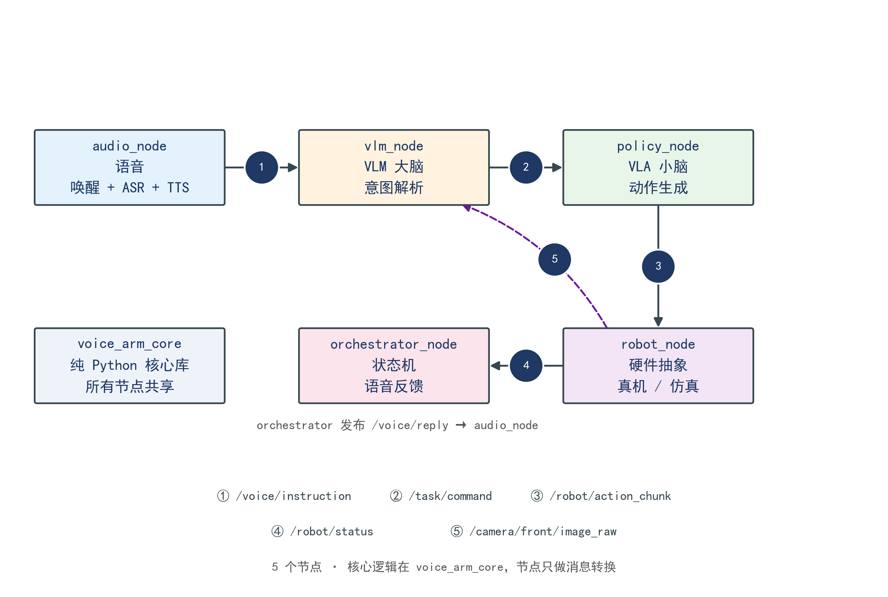
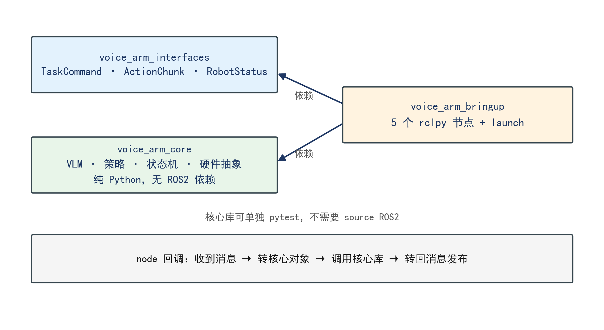

<div align="center">

# vlm-vla-voice-arm

**VLM 大脑 + VLA 小脑的中文语音控制机械臂系统**

使用者用日常口语下达抓放指令，机械臂完成目标选择、抓取与放置，并以语音回复结果。


</div>

---

## 系统架构


系统分为两层，两层之间以结构化指令为唯一接口：

| 层次 | 角色 | 输入 | 输出 |
|:---|:---|:---|:---|
| **VLM** | 大脑 | 指令文本 + 桌面图像 | 结构化动作指令（抓哪个、放哪里） |
| **VLA** | 小脑 | 图像 + 语言条件 | 关节动作块（16 步 × 6 关节） |

**两条硬约束：**

- VLM 不接触关节空间，只做语义决策
- VLA 不解析自然语言，语言条件在训练时注入

任意一层的模型更换都不影响另一层。

---

## ROS2 节点拓扑



| # | 话题 | 类型 | 方向 |
|:---:|:---|:---|:---|
| ① | `/voice/instruction` | `std_msgs/String` | audio → vlm |
| ② | `/task/command` | `voice_arm_interfaces/TaskCommand` | vlm → policy, orchestrator |
| ③ | `/robot/action_chunk` | `voice_arm_interfaces/ActionChunk` | policy → robot |
| ④ | `/robot/status` | `voice_arm_interfaces/RobotStatus` | robot → orchestrator |
| ⑤ | `/camera/front/image_raw` | `sensor_msgs/Image` | robot → vlm |
| — | `/robot/joint_states` | `sensor_msgs/JointState` | robot → 外部监控 |
| — | `/voice/reply` | `std_msgs/String` | orchestrator → audio |

---

## 包结构



```
ros2_ws/src/
├── voice_arm_interfaces/      自定义消息
│   └── msg/{TaskCommand,ActionChunk,RobotStatus}.msg
├── voice_arm_core/            纯 Python 核心库（无 ROS2 依赖）
│   ├── voice_arm/
│   │   ├── audio/             唤醒词 · ASR · TTS
│   │   ├── vlm/               schema · prompts · client
│   │   ├── policy/            runner · dataset · train
│   │   ├── robot/             interface · sim · real
│   │   ├── app/               state_machine · orchestrator
│   │   └── utils/             config · logging
│   └── tests/                 12 个单元测试
└── voice_arm_bringup/         5 个 rclpy 节点 + launch
    ├── voice_arm_bringup/{audio,vlm,policy,robot,orchestrator}_node.py
    ├── launch/{sim,real}.launch.py
    └── config/params.yaml
```

**设计原则：核心逻辑不进节点。**

节点只做三件事：收到消息 → 转成核心对象 → 调用核心库 → 转回消息发布。这样单元测试不需要 ROS2 环境，单独调试某个模块也不用启动整套系统。

---

## 快速开始

```bash
# 1. 依赖（Ubuntu 22.04）
sudo apt install ros-humble-desktop python3-colcon-common-extensions
pip install -e "ros2_ws/src/voice_arm_core[dev]"

# 2. 构建
make build

# 3. 单元测试（不需要 source ROS2）
make test

# 4. 仿真启动
make sim

# 5. 另开终端检查
ros2 node list
ros2 topic hz /robot/status
```

真机启动：

```bash
make real
```

---

## 当前进度

| 模块 | 状态 | 说明 |
|:---|:---:|:---|
| ROS2 骨架与话题 | ✅ | 三个包、五个节点、两套 launch |
| 核心库接口 | ✅ | 12 个测试通过 |
| 仿真节点 | ✅ | 可启动，产生占位动作 |
| VLM 接入 | ⏳ | 调 `voice_arm_core.vlm.client.VLMClient` |
| 策略推理 | ⏳ | 调 `voice_arm_core.policy.runner.PolicyRunner` |
| 真机驱动 | ⏳ | 队友实现 `robot_node` 回调 |
| 语音链路 | ⏳ | openWakeWord + FunASR + edge-tts |

**硬件选型尚未确定。** 接口契约已固定（见 [docs/interface.md](docs/interface.md)），硬件侧按契约实现即可，上层代码不需要改。

---

## 文档

| 文档 | 内容 |
|:---|:---|
| [架构说明](docs/architecture.md) | 两层结构、数据流、真机/仿真切换 |
| [接口契约](docs/interface.md) | 7 个方法、频率、单位、验收标准 |
| [指令 Schema](docs/schema.md) | VLM 输出结构、字段约束、降级规则 |
| [环境搭建](docs/setup.md) | Ubuntu 22.04 + ROS2 Humble 完整步骤 |

---

## 参考

- [LeRobot](https://github.com/huggingface/lerobot) — 数据格式、训练与推理框架
- [SmolVLA](https://arxiv.org/abs/2506.01844) — 轻量视觉语言动作模型（450M）
- [ACT](https://arxiv.org/abs/2304.13705) — 动作分块模仿学习
- [OpenVLA](https://github.com/openvla/openvla) — 开源 VLA 参考实现

---

## License

[MIT](LICENSE)
