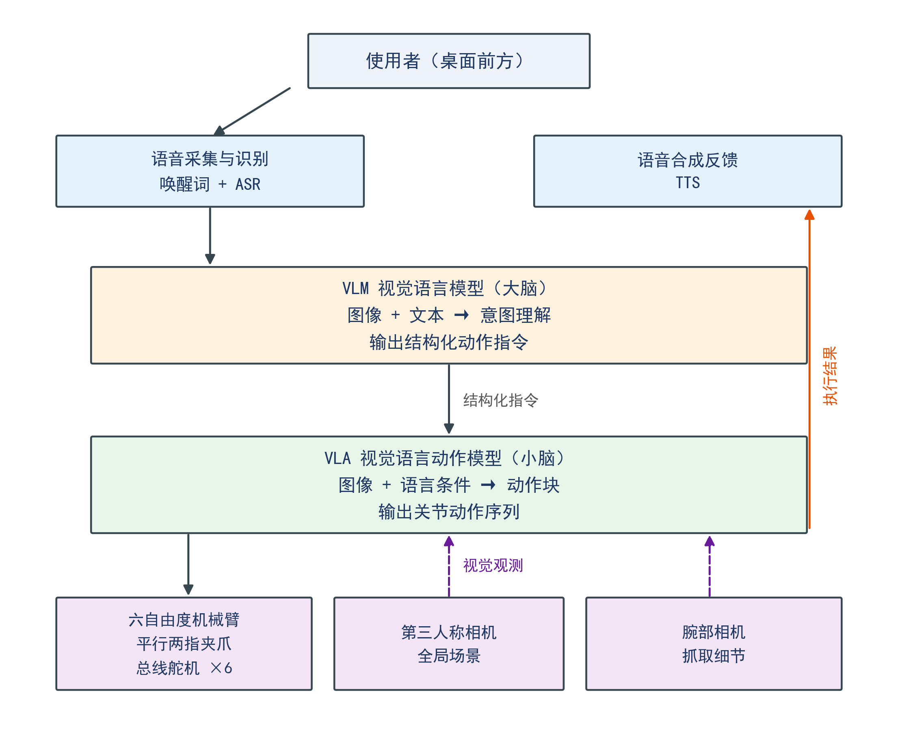
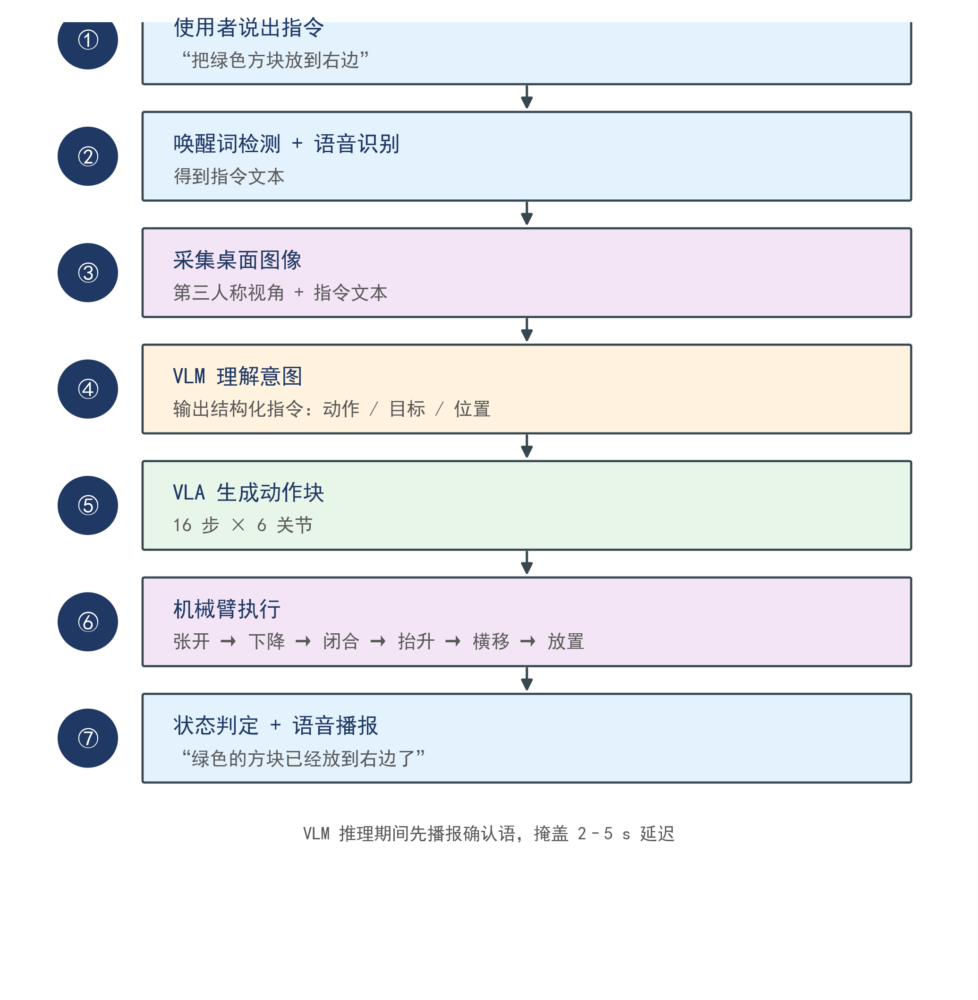

# 架构说明

## 两层结构

```
使用者语音 → 唤醒 + ASR → 中文文本
                            ↓
                    VLM（大脑）
        中文文本 + 桌面图像 → 英文任务指令
                            ↓ 唯一接口
                    VLA（小脑）
          图像 + 英文指令 → 关节动作块
                            ↓
                     机械臂执行 → 语音反馈
```



---

## 职责边界

| 模块 | 输入 | 输出 | 是否看图 |
|:---|:---|:---|:---:|
| 语音 | 音频流 | 中文文本 | ❌ |
| VLM | 中文文本 + 桌面图像 | 英文任务指令 + 存在性 + 方位 | ✅ |
| VLA | 图像 + 英文指令 | 关节动作块 | ✅ |
| 语音反馈 | 执行结果 | 播报文本 | ❌ |

**关键分工：VLA 自己会看图。** 目标在画面中的位置由 VLA 从图像中学到，不需要 VLM 输出坐标。

---

## VLM 做什么

### 1. 语言翻译（主要职责）

把中文口语统一成固定模板的英文指令：

```
"把绿色的方块抓起来"  → "pick up the green cube"
"拿一下那个绿的"      → "pick up the green cube"
"帮我把绿方块拿过来"  → "pick up the green cube"
```

模板必须与训练数据完全一致，否则文本嵌入偏移会导致动作异常。

### 2. 目标存在性确认

判断画面中是否存在指令所指的物体：

```json
{"target_present": false, "reply": "我没有看到绿色的方块"}
```

不存在时直接语音提示，不启动机械臂，避免空跑一次。

### 3. 方位描述（仅用于对话）

给出目标的大致方位（left / center / right）：

```json
{"position_hint": "left", "reply": "好的，我看到左边的绿色方块了"}
```

**方位不进入 VLA 的输入**，只用于语音播报与日志。

---

## VLM 不做什么

| 不做 | 原因 |
|:---|:---|
| 输出像素坐标或三维坐标 | VLA 直接从图像学习位置，不需要中转 |
| 规划动作轨迹 | 属于 VLA 职责，VLM 不接触关节空间 |
| 把方位写进 VLA 的指令文本 | 会改变文本分布，且与图像信息重复 |

### 为什么方位不进 VLA 输入

1. **信息重复**：图像里已经有位置，文本再说一遍是冗余
2. **分布偏移**：训练时是 `pick up the green cube`，推理时变成 `pick up the green cube on the left`，多出的词会让嵌入偏移
3. **误差污染**：VLM 方位判断错误时，会覆盖 VLA 从图像得到的正确判断

如果要让方位参与控制，训练数据里也必须带方位，且每条都要标注准确——这会显著增加采集成本，收益有限。

---

## VLA 做什么

- 接收当前图像与英文指令
- 输出未来若干步的关节动作块（16 步 × 6 关节）
- 从训练数据中学习“看到什么位置 → 手怎么动”

VLA 不解析自然语言，语言条件在训练时注入，推理时只接收编码后的条件向量。

---

## 数据流



---

## 数据采集规范

位置随机是前提。以下四条缺任何一条，语言条件都可能失效。

### 1. 初始位置必须打散

每条演示把物体放在桌面的不同位置，每类的 50 条演示应覆盖至少 9 个不同位置。

如果所有演示都从同一个点出发，VLA 会学成"记住一条轨迹"，不看图像也能做对。

### 2. 颜色与位置必须交叉

| 正确 | 错误 |
|:---|:---|
| 红色有时在左、有时在右 | 红色永远在左边 |
| 蓝色有时在左、有时在右 | 蓝色永远在右边 |

如果颜色和位置绑定，模型会学成"按位置选"，完全忽略指令。这是最容易被忽略、也最致命的一个错误。

### 3. 指令模板必须统一

训练数据中的 `task` 字段统一使用：

```
pick up the {color} {shape}
```

不要在同一个数据集里混用 `grab` / `pick` / `take`，也不要一会儿加 `please`，一会儿加 `the object on the table`。

### 4. 每类数量与配比

| 项目 | 要求 |
|:---|:---|
| 每类演示数 | 50 条起 |
| 类别数 | 5 类（颜色 × 形状组合） |
| 总条数 | 250 条 |
| 单条时长 | 5–15 秒 |
| 有效成功率 | 采集时人工剔除失败演示 |

---

## 语言条件验证

训练完成后必须做对照测试，否则无法证明语言真的起作用。

### 测试方法

固定场景与物体位置，只改变指令：

```
第 1 次：说"抓红色的"  → 记录目标颜色
第 2 次：说"抓蓝色的"  → 记录目标颜色
```

### 判定标准

| 结果 | 含义 |
|:---|:---|
| 两次抓的是不同物体 | ✅ 语言条件生效 |
| 两次抓的是同一个物体 | ❌ 语言条件失效，模型在按位置或最近距离选择 |

### 失效时的排查顺序

1. 检查采集数据中颜色与位置是否绑定
2. 检查训练时 `task` 字段是否为每条演示的真实指令
3. 检查推理时的指令模板是否与训练一致
4. 检查模型是否只训练了单一类别

---

## 真机与仿真

`robot/sim.py` 与 `robot/real.py` 实现同一个 `RobotInterface`。
上层代码通过 `params.yaml` 中的 `robot.backend` 切换，不做任何代码分支。

| 后端 | 用途 | 状态 |
|:---|:---|:---|
| `sim` | 无硬件联调、数据预训练 | 可用（返回合成图像与零动作） |
| `real` | 真机部署 | 待硬件负责人实现 |
